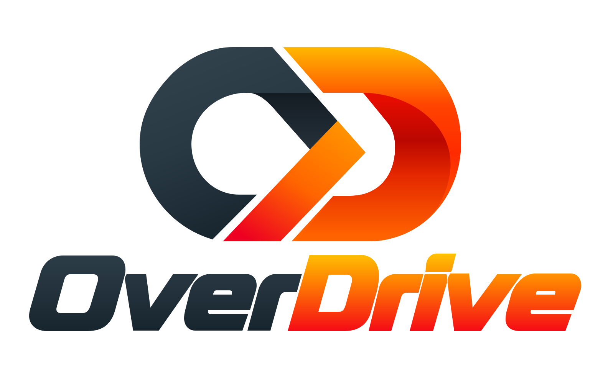

<div align="center">
  
  <p><strong>An open source toolbox for visual tasks, built on PyTorch.</strong></p>

[](docs/en/get_started.md#requirements)
[](docs/en/get_started.md#requirements)
[](LICENSE)

[Installation](#installation) |
[Getting Started](#getting-started) |
[Model Zoo](#model-zoo) |
[FAQ](#faq) |
[Reporting Issues](https://github.com/tkhe/OverDrive/issues)

English | [简体中文](README_zh.md)

</div>

## Introduction

OverDrive is an open source PyTorch framework and toolbox for visual tasks, designed to provide a flexible, modular, and extensible foundation. With reusable model components, a flexible configuration system, and unified, customizable interfaces for data processing, training, and evaluation, it helps developers efficiently implement algorithms, run experiments, and explore new visual tasks.

OverDrive requires **PyTorch 2.6+**. Use **Python 3.10+** and a compatible TorchVision installation.

<details open>
<summary>Major features</summary>

- **Modular design**

  Reuse model components and customize data pipelines, training loops, hooks, and evaluators to build models and workflows for different visual tasks.

- **Flexible experiment configuration**

  Use Python LazyConfig to compose shared model and training configurations. Define components with `LazyCall`, construct them with `instantiate`, and override experiment settings from the command line.

- **Training, evaluation, and visualization**

  Use epoch-based or iteration-based training, distributed execution, mixed precision, gradient accumulation, checkpoint resumption, and TensorBoard logging. Dataset evaluators and image, video, and webcam demos support the experiment workflow.

</details>

## What's New

- **v1.0.0**: Initial release covering object detection, instance segmentation, keypoint detection, semantic segmentation, and panoptic segmentation, with modular models, LazyConfig, training, evaluation, and inference tools.

See the [full changelog](docs/en/changelog.md) for details.

## Installation

Install PyTorch and TorchVision for your platform using the [official PyTorch installation guide](https://pytorch.org/get-started/locally/), then install OverDrive from source:

```bash
git clone https://github.com/tkhe/OverDrive.git
cd OverDrive
python -m pip install -e . --no-build-isolation
```

Installation compiles a C++ extension and requires a compatible compiler toolchain. See the [installation guide](docs/en/get_started.md#installation) for virtual environment setup, CPU/CUDA requirements, optional dependencies, and installation checks.

## Getting Started

Follow the [User Guide](docs/en/get_started.md) to prepare data, train a model, evaluate a checkpoint, and run inference. The examples use Faster R-CNN with ResNet-50 FPN on COCO.

<details open>
<summary>User guides</summary>

- [Prepare datasets](docs/en/get_started.md#dataset-preparation)
- [Train on one GPU](docs/en/get_started.md#training-on-one-gpu)
- [Train on multiple GPUs or machines](docs/en/get_started.md#training-on-multiple-gpus-or-machines)
- [Resume training](docs/en/get_started.md#resuming-training)
- [Evaluate a model](docs/en/get_started.md#evaluating-a-model)
- [Run image, video, and webcam inference](docs/en/get_started.md#image-video-and-webcam-inference)
- [Use the Python inference API](docs/en/get_started.md#python-inference-api)

</details>

<details>
<summary>Advanced guides</summary>

- [Understand and customize configurations](docs/en/advanced_usage.md#configuration-and-experiment-management)
- [Register custom datasets](docs/en/advanced_usage.md#custom-datasets)
- [Explore the project structure and visualization tools](docs/en/advanced_usage.md#project-structure)

</details>

## Model Zoo

Browse [configs/](configs) for experiment configurations and the corresponding papers. Shared models, data pipelines, optimizers, and schedules are organized under [configs/common](configs/common).

### Architectures

<table>
  <thead>
    <tr>
      <th>Object Detection</th>
      <th>Instance Segmentation</th>
      <th>Keypoint Detection</th>
      <th>Semantic Segmentation</th>
      <th>Panoptic Segmentation</th>
    </tr>
  </thead>
  <tbody>
    <tr>
      <td valign="top">
        <ul>
          <li><a href="configs/COCO-Detection/faster_rcnn">Faster R-CNN</a></li>
          <li><a href="configs/COCO-Detection/cascade_rcnn">Cascade R-CNN</a></li>
          <li><a href="configs/COCO-Detection/retinanet">RetinaNet</a></li>
          <li><a href="configs/COCO-Detection/fcos">FCOS</a></li>
          <li><a href="configs/COCO-Detection/autoassign">AutoAssign</a></li>
          <li><a href="configs/COCO-Detection/detr">DETR</a></li>
          <li><a href="configs/COCO-Detection/conditional_detr">Conditional DETR</a></li>
          <li><a href="configs/COCO-Detection/dab_detr">DAB-DETR</a></li>
          <li><a href="configs/COCO-Detection/deformable_detr">Deformable DETR</a></li>
        </ul>
      </td>
      <td valign="top">
        <ul>
          <li><a href="configs/COCO-InstanceSegmentation/mask_rcnn">Mask R-CNN</a></li>
          <li><a href="configs/COCO-InstanceSegmentation/cascade_mask_rcnn">Cascade Mask R-CNN</a></li>
        </ul>
      </td>
      <td valign="top">
        <ul>
          <li><a href="configs/COCO-Keypoint/keypoint_rcnn">Keypoint R-CNN</a></li>
        </ul>
      </td>
      <td valign="top">
        <ul>
          <li><a href="configs/ADE20K-SemanticSegmentation/deeplabv3">DeepLab v3</a></li>
          <li><a href="configs/ADE20K-SemanticSegmentation/deeplabv3plus">DeepLab v3+</a></li>
          <li><a href="configs/ADE20K-SemanticSegmentation/upernet">UPerNet</a></li>
        </ul>
      </td>
      <td valign="top">
        <ul>
          <li><a href="configs/COCO-PanopticSegmentation/panoptic_fpn">PanopticFPN</a></li>
        </ul>
      </td>
    </tr>
  </tbody>
</table>

### Datasets and Evaluation

Built-in dataset interfaces cover **COCO, LVIS, Cityscapes, ADE20K, PASCAL VOC, and VisDrone**. The [evaluation module](overdrive/evaluation) provides detection, instance segmentation, keypoint, semantic segmentation, and panoptic segmentation evaluators.

See the [dataset preparation guide](docs/en/get_started.md#dataset-preparation) and [dataset implementations](overdrive/data/datasets) for annotation formats and registration names. Configure additional backbones and datasets to match the model's feature shapes and task requirements.

## FAQ

See the [FAQ](docs/en/faq.md) for installation, operator compatibility, dataset paths, GPU memory, checkpoint loading, and command-line overrides.

For other questions, open a [GitHub issue](https://github.com/tkhe/OverDrive/issues) with your environment information, configuration, full command, and relevant logs.

## Contributing

We welcome bug reports, fixes, new visual tasks and models, dataset integrations, and documentation improvements. Contributions for new tasks or models should include implementations, experiment configurations, and reproducible validation instructions. Standalone research extensions can be organized under [projects/](projects).

Changes to model behavior, data processing, or the training engine should include the corresponding runtime validation results.

## Acknowledgements

We thank the following open source projects for their tools and research contributions:

- [PyTorch](https://github.com/pytorch/pytorch)
- [TorchVision](https://github.com/pytorch/vision)
- [Detectron2](https://github.com/facebookresearch/detectron2)
- [detrex](https://github.com/IDEA-Research/detrex)
- [MMDetection](https://github.com/open-mmlab/mmdetection)
- [MMSegmentation](https://github.com/open-mmlab/mmsegmentation)
- [timm](https://github.com/huggingface/pytorch-image-models)

## License

OverDrive is released under the [MIT License](LICENSE). Datasets, third-party code, and pretrained weights are subject to their own licenses and release terms.
